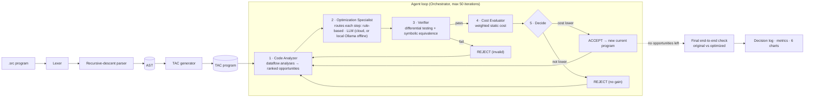

# Automated LLM/Agent-Guided Compiler Code Optimization

A multi-agent system that compiles programs written in a small C-like language
to **Three-Address Code (TAC)** and then optimizes the TAC in an agent loop:

**Analyze → Propose → Verify → Evaluate → Accept/Reject**

Every candidate transformation must pass verification **before** it is even
costed, so an incorrect optimization can never be accepted. On the bundled
500-program dataset, the rule-based agent alone reaches an **82.5 % average
cost reduction**. With Google Gemini as an additional proposer it reaches
**91.5 %**. Both runs have **zero false positives**.

| Result (500 programs) | Rule-based only | Rule-based + Gemini |
|---|---|---|
| Average cost reduction | 82.49 % | **91.50 %** (median 97.53 %) |
| Programs with > 30 % reduction | 500 / 500 | 500 / 500 |
| Proposals / verified / accepted | 10,628 / 10,628 / 10,517 | 10,978 / 10,952 / 10,828 |
| Verification pass rate | 100.00 % | 99.76 % |
| Acceptance rate (of verified) | 98.96 % | 98.87 % |
| Steps to convergence (mean / median) | 22.2 / 20 | 22.7 / 20.5 |
| LLM validity rate | n/a | 92.35 % (26 wrong proposals blocked) |
| False positives (output mismatch) | **0** | **0** |

The rule-only run is kept in `output_rule_only/`; the Gemini run is in `output/`.
Two more runs use the other LLM backends, both also with zero false positives:

| Run | Folder | Average cost reduction | LLM validity rate |
|---|---|---|---|
| Rule-based + Groq (`gpt-oss-120b`, then `gpt-oss-20b`) | `output_groq/` | **90.89 %** | 98.11 % |
| Rule-based + Ollama (`qwen2.5-coder:7b`, offline) | `output_ollama/` | **83.28 %** | 42.93 % |

See [Results with Groq](#results-with-groq-gpt-oss-free-tier) and
[Results with Ollama](#results-with-ollama-qwen25-coder7b-offline-on-cpu).

---

## Architecture



```
src/
  frontend/   lexer.py, parser.py, ast_nodes.py, tac_generator.py
  tac/        instruction.py, program.py, interpreter.py, printer.py, dataflow.py
  agents/     orchestrator.py, code_analyzer.py, optimization_specialist.py (router),
              optimizer_rule.py, optimizer_llm.py (Gemini, Groq, Ollama),
              verifier.py, cost_evaluator.py, decision_log.py
  visualization/  charts.py, report.py
  frontend/c_frontend.py   C-subset front end used by the live demo
dataset/      generator.py, programs/<category>/*.src
demo.py       terminal front end: optimize a C program step by step
demo_programs/  sample C programs for the demo
tests/        one test module per component, plus regression tests (336 tests)
output/       logs/ (per-program .log + .json), metrics/ (CSV + JSON), plots/ (PNG)
```

`src/tac/dataflow.py` is one addition to the requested layout. It holds the
CFG, liveness, available-copies and definite-assignment analyses, which the
analyzer, the optimizer and `TACProgram.get_input_variables()` all use.

---

## Installation

```bash
pip install -r requirements.txt
```

Python 3.10+ is required (the code uses `match` statements). PNG export of
the Sankey diagram uses `kaleido`, which needs a Chrome/Chromium/Edge browser
installed. The HTML version of the Sankey is always written next to the PNG.

## Usage

The commands below use the Windows launcher `py`. On Linux or macOS, use
`python3` instead. (On Windows, plain `python` may open the Microsoft Store
instead of running Python.)

```bash
py main.py --generate-dataset                     # 500 programs -> dataset/programs/
py main.py --run-all --output-dir output          # optimize everything, print logs + metrics
py main.py --run-all --quiet                      # same, but only progress lines on the console
py main.py --run-file dataset/programs/loops/loops_001.src
py main.py --visualize --output-dir output        # the 6 charts, from saved results
py main.py --run-all --use-llm                    # add the LLM proposer (Gemini or Groq; Ollama if offline)
py main.py --run-file my.src --offline            # LLM = local Ollama model, no internet needed
py main.py --run-file my.src --offline --optimizer llm   # route to the LLM first, the rules second
py main.py --run-all --dataset real --output-dir output_real_rule_only   # the 500 real C programs instead
```

| Flag | Meaning |
|---|---|
| `--max-iterations N` | iteration cap per program (default 50) |
| `--optimizer MODE` | how the Optimization Specialist routes each step: `rule` (default), `hybrid` or `llm`; see [routing](#routing-rule-based-or-llm) |
| `--use-llm` | enable the LLM proposer alongside the rules (same as `--optimizer hybrid`) |
| `--offline` | offline mode: the LLM is a local Ollama model (implies `--optimizer hybrid` unless one is given) |
| `--llm-provider P` | `auto` (default: `gemini` or `groq` when online and a key is set, otherwise `ollama`), `gemini`, `groq` or `ollama` |
| `--llm-model ID` | model for the LLM (defaults: `gemini-3.1-flash-lite`, `openai/gpt-oss-120b`, `qwen2.5-coder:7b`) |
| `--compare-with DIR` | with `--visualize`: compare against another run (writes `comparison.csv` and chart 7) |
| `--max-llm-calls N` | LLM proposals allowed per program (default 5) |
| `--max-repairs N` | self-repair: second tries the LLM gets after a rejected answer (default 1, 0 turns it off); see [self-repair](#llm-self-repair) |
| `--cost-model M` | what counts as cheaper: `static` (default) or `time`; see [execution time](#execution-time-in-the-cost-model) |
| `--resume` | with `--run-all`: continue an interrupted run (finished programs are kept in `metrics/records_cache.jsonl`), or extend a finished one |
| `--every K` | with `--run-all`: only every K-th program, a sample spread evenly over the categories |
| `--quiet` | with `--run-all`, print only progress; logs are still saved |
| `--dataset NAME` | with `--run-all`: `generated` (default) or `real`; see [real programs](#real-programs-the-codeforces-dataset) |

## Live demo: the terminal front end

`demo.py` takes a real C program and walks through the whole pipeline on
screen, pausing between stages:

```bash
py demo.py                                  # menu: pick a sample, paste code, or type a path
py demo.py demo_programs/3_loop.c           # run one file
py demo.py my_program.c --fast              # no pauses
py demo.py my_program.c --inputs n=10       # values for scanf() variables
py demo.py my_program.c --use-llm           # add the LLM proposer (Gemini or Groq; Ollama if offline)
py demo.py my_program.c --offline           # add the local Ollama model as the LLM proposer
py demo.py my_program.c --verbose           # show every decision, including repeats and routing
py demo.py my_program.c --cost-model time   # judge changes by measured execution time first
ollama_demo.bat                             # offline demo with the local model, sample 6 (Windows)
ollama_demo.bat my_program.c --inputs n=5   # the same for any C file
```

| Stage | What it shows |
|---|---|
| 1 | The C program |
| 2 | The Three-Address Code it becomes, with its cost |
| 3 | Each agent decision: what was suggested, verified or not, cost before and after, accepted or rejected |
| 4 | **Suggestion counts**: how many came from the rules, from the LLM and in total, and how many of each were verified, accepted, rejected for no gain, or invalid; then the same by optimization type |
| 5 | Original and optimized code side by side, with the cost reduction |
| 6 | Proof: both versions are run and their outputs compared |

The demo accepts a subset of C (`src/frontend/c_frontend.py`):

* **Supported:** `#include`, `int main()`, `int` variables with C block
  scoping, `if / else if / else`, `while`, `for`, `+= -= *= /= %= ++ --`,
  `printf("%d", ...)` and `scanf("%d", &x)`, `return` anywhere in `main`,
  character literals, `bool`, `long long` and integer `typedef`s.
* **Not supported:** arrays, pointers, other functions, `float`/`char`
  variables, `break`/`continue`. These stop with a message such as
  `C error at line 3: arrays are not supported`.
* **`scanf` variables** become program inputs, which the verifier tests with
  many values.
* **Text inside `printf`** is ignored: only the `%d` values are printed.
* **Programs that run too long** (more than 100,000 executed instructions)
  cannot be verified by running them, so the demo stops and says so.

The front end was checked against real `gcc`: random C programs were compiled
with gcc and run, and their output had to match both the unoptimized and the
optimized TAC.

## Real programs: the Codeforces dataset

The generated dataset is written to contain what the optimizer looks for. To
see how the system does on code people actually wrote, a second dataset holds
**500 real programs**: accepted submissions to Codeforces problems, taken from
[`open-r1/codeforces-submissions`](https://huggingface.co/datasets/open-r1/codeforces-submissions)
on Hugging Face (2025, CC-BY-4.0, 12.6 million submissions).

```bash
pip install pyarrow                             # only the two download steps need it
py dataset/real_dataset.py collect              # download 6 files (about 150 MB each), keep what is usable
py dataset/real_dataset.py select               # choose the 500 -> dataset/real_programs/
py dataset/real_dataset.py rebuild              # or: write the same 500 again from the manifest
py main.py --run-all --dataset real --quiet --output-dir output_real_rule_only
```

* **What is kept.** A submission is usable when the judge accepted it, the C
  front end compiles it in strict mode, it prints something, and it finishes
  within 20,000 steps on every input set the verifier would try. Of 469,491
  accepted C and C++ submissions that print with `printf` or `puts`, 9,489
  were usable (2.0 %), from
  234 problems. The rest mostly use arrays, other functions, floating point,
  macros, or read input inside a loop.
* **C and C-style C++.** 86 of the 500 were submitted as C. The other 414
  were submitted to a C++ compiler but are written in C (`scanf`/`printf`,
  no C++ features); the front end skips `using namespace std;` and refuses
  anything else from C++.
* **The same proportions as the generator.** 60 arithmetic, 60 nested, 60
  repeated_expr, 60 dead_code, 80 loops, 80 conditionals, 100 mixed. A
  program with a stored value that is never read is `dead_code`; one with
  the same arithmetic expression written twice is `repeated_expr`; the rest
  go by control flow, and straight-line programs by how deep their
  arithmetic is (`category_of` in `dataset/real_dataset.py`).
* **Spread over problems.** Each category is filled one program per problem
  per round, newest submission first, and programs that compile to the same
  TAC count once. The 500 come from 207 problems. Straight-line solutions
  are rare on Codeforces, so `arithmetic` draws on only 16 problems and
  `nested` on 25.
* **Strict mode.** For these programs the text a program prints counts as
  output: `puts("YES")` becomes `print 1000000`, one code per distinct text,
  so an optimization that changed which message is printed would fail
  verification. `a && b` is refused when `b` divides, because TAC evaluates
  both sides and C would not.
* **Limits of the model.** Integers are unbounded (no 32-bit wrap-around),
  and inputs are tested over the verifier's value ranges, which include
  values a problem's statement rules out (negative or zero sizes).
* **Where the files are.** The 500 programs are in `dataset/real_programs/`,
  each with its submission id, link and the dataset's licence in a header
  comment. The downloaded data (`dataset/real_cache/`) stays on the machine.
  `dataset/real_manifest.json` lists the 500 submission ids, so `rebuild`
  recreates exactly the same set.

## Running the tests

```bash
py -m pytest tests/ -v
```

397 tests cover every component (the SMT tests are skipped when `z3-solver` is not installed). The Ollama and Groq tests run against stand-in
local servers, so they need no Ollama, API key or network. The verifier tests inject wrong changes
(bad folds, operand swaps, CSE across non-commutative ops, deleted live
stores, off-by-one conditions, removed loop increments, deleted trapping
divisions, reordered output). Each one must be rejected.

---

## The mini-language

```c
int a = 3 + 5;                 // declarations (int x; initialises to 0)
a = a * 2;                     // assignment
if (a > 10 && a != 12) { print(a); } else { print(0); }
while (a > 0) { a = a - 3; }
for (int i = 0; i < 4; i = i + 1) { print(i % 2); }
```

Operators: `+ - * / %`, comparisons `== != < > <= >=`, logical `&& || !`,
unary `-`. Integers are unbounded. `/` truncates toward zero and `%` follows
the sign of the dividend (C semantics). `&&`/`||` evaluate both operands.
`//` and `/* */` comments are supported.

A variable that is read but never assigned is a **program input**. Dataset
programs that use inputs list them in an `// inputs:` header comment, and the
verifier feeds them values.

---

## The agent loop

1. **Analyze** (`code_analyzer.py`). Every analysis runs on the
   instruction-level control-flow graph, so it is sound for loops and
   branches, not only straight-line code.

   | Opportunity | Priority | Detection |
   |---|---|---|
   | `CONSTANT_FOLD` | 100 | binary/unary op on literals (`5 / 0` is never folded) |
   | `ALGEBRAIC_SIMPLIFY` | 90 | `x+0, 0+x, x-0, x*1, 1*x, x*0, 0*x, x/1, x-x, x%1` |
   | `DEAD_CODE` | 80 | result not live (backward liveness analysis), and the instruction cannot trap |
   | `CSE` | 70 | same `(op, a, b)` in one basic block, commutative ops normalised, operands and first result not redefined in between |
   | `STRENGTH_REDUCTION` | 60 | `x*2 → x+x`, `x*2^k → x<<k` |
   | `COPY_PROPAGATION` | 50 | `x = y` propagated wherever the copy is *available* (forward must-analysis), plus copy coalescing `t = a op b; x = t → x = a op b` |

2. **Propose** (`optimization_specialist.py`). The Optimization Specialist
   routes the step to one of its two proposers. The rule-based one
   (`RuleBasedOptimizer.propose()`) deep-copies the program and applies
   exactly one opportunity. The LLM one sends the TAC to a language model
   and asks for one optimization; the reply is parsed back into TAC. Either
   proposal goes through the same gates. See
   [routing](#routing-rule-based-or-llm) for who is asked when.
3. **Verify** (`verifier.py`). Both checks must pass:
   * **Differential testing.** The original and candidate run in the TAC
     interpreter on 20 random input sets (values in [-100, 100]) plus edge
     cases (all 0 / 1 / -1 / 99 / -99). When there are free inputs, it also
     adds:
     * boundary values `c-1, c, c+1` for every literal `c` in either program;
     * **small-scope sets**: every combination of a few small values, zero
       included, over all inputs (one input: every value from -128 to 128;
       two inputs: all 289 pairs from -8..8; five inputs: all 243
       combinations of -1, 0, 1). Random values almost
       never make one input zero and another non-zero, which is exactly
       what tells `&&` from `||` or flips a branch on a flag;
     * **pairwise boundary sets**: every pair of inputs gets every pair of
       boundary values (and zero) at least once, for changes that only show
       when one input sits on a boundary while another steers the branch.

     Printed output *and* failure mode (division by zero, timeout,
     undefined variable) must match. Both programs timing out counts as
     inconclusive and is rejected.
   * **Symbolic verification** (straight-line code). Values become canonical
     integer polynomials, so `x*2 ≡ x+x ≡ x<<1` and `a+b ≡ b+a`. Comparisons
     are normalised, so `x > y ≡ y < x`. Printed expressions must be
     identical, and so must the set of divisors that could trap before each
     print. For programs with branches or loops this step is skipped and the
     log says so.
4. **Evaluate** (`cost_evaluator.py`):
   `cost = 1.0·instructions + 2.0·arithmetic + 0.5·temps + 1.5·copies + 1.0·branches`.
   A candidate is accepted only if this cost **strictly** decreases.
5. **Accept/Reject.** An accepted candidate becomes the current program, and
   the "already tried" set is cleared because new opportunities may appear.
   Rejected opportunities are not retried until something else is accepted.
   The loop ends when nothing is left to try or the iteration cap is hit.
   If the program itself does not finish within the verifier's step limit,
   no change to it can be checked, so the loop stops at once and leaves the
   program unchanged.
   Finally the optimized program is verified once more against the untouched
   original (`output_match`).

### Why zero false positives

* Nothing is accepted without passing the verifier. The final check
  re-verifies the end result against the original.
* A dataset program with no free inputs has exactly one possible execution,
  so a differential match is a *proof* of equivalence for it.
* For straight-line code with inputs, the symbolic check proves equivalence
  for all inputs (within the polynomial normal form).
* For branching code with inputs, differential testing is strong but not
  exhaustive. That matters only for LLM proposals: the rule-based
  transformations are correct by construction, and the verifier is their
  safety net.

### Design notes on the cost model

The cost weights make a copy (`x = y`, 2.5) dearer than a comparison or
unary op (1.0). So some textbook steps would *raise* cost when applied alone,
and the strict cost gate would reject them. Three rules take care of this:

* **Copy propagation** removes the copy in the same step when it becomes dead.
  Otherwise the step would be cost-neutral.
* **Constant folding** of a comparison, logical, shift or unary op forwards
  the folded constant into its uses in the same step. Arithmetic folds are
  a plain replace, as specified.
* **CSE** of a comparison, logical or shift expression forwards the copy
  into its uses in the same step, for the same reason. Arithmetic CSE is a
  plain replace, as specified.

`x*2 → x+x` is cost-neutral under these weights, so the evaluator rejects it.
These are the 97 strength-reduction rejections in the results. `x*4 → x<<2`
is accepted, because a shift is not one of the arithmetic ops `+ - * / %`.

---

## Execution time in the cost model

The static cost counts what is in the program text. It cannot tell an
instruction inside a loop from one outside it. The Cost Evaluator therefore
also measures **execution time**:

* The program is run on 25 fixed inputs (20 random sets, half of them
  positive, and 5 edge cases). A variable's values depend only on its name,
  so a program and a candidate are timed on the same data.
* Every executed instruction adds a latency: copy 1, `+ - <<` and comparisons
  1, multiply 3, divide and modulo 20, `goto` 1, conditional branch 2, print 1,
  label 0. The time is the average over the runs.
* `--cost-model static` (default) accepts a change if the static cost drops.
  `--cost-model time` accepts it if the measured time drops, or the time is
  equal and the static cost drops. Replacing `x * 2` by `x + x` is a tie for
  the static model and a gain for the time model.
* Every run reports both reductions, whichever model decides.

## SMT verification with Z3

Differential testing shows that two programs agree on the inputs that were
tried. For programs with branches but **no loops**, the verifier can do
better (`src/agents/smt_verifier.py`):

1. Every path of both programs is followed symbolically. A branch splits the
   path; a division splits off the case "the divisor is zero".
2. The paths are folded into one description of a run: how it ends, how many
   values it prints, and the values.
3. Z3 is asked for an input on which the two descriptions differ.

| Answer | Meaning |
|---|---|
| `unsat` | no such input exists: **proved equivalent for all inputs** |
| `sat` | Z3 returns the input; it is replayed in the interpreter and the change is rejected |
| `unknown` | no answer in 3 seconds (usually non-linear arithmetic); the tested verdict stands |

The stage runs on every LLM proposal and on the end-to-end check of every
program. If the end-to-end check ever fails, the original program is kept and
the result is marked as reverted. Z3 is optional: `pip install z3-solver`.
Without it the stage is skipped and everything else works as before.

## Metrics

| Metric | Definition |
|---|---|
| Verification pass rate | proposals passing verification / all proposals |
| Acceptance rate | accepted / proposals that passed verification |
| Average cost reduction | mean of `(original − final) / original × 100` over programs |
| Steps to convergence | iterations per program (mean, median, min/max, distribution) |
| LLM validity rate | LLM proposals passing verification / LLM proposals (only with `--use-llm`) |
| False positives | programs whose optimized output differs from the original. **Must be 0** |

The console summary also lists **suggestions by source**: how many
proposals came from the rules, from the LLM and in total, and how many of
each were verified, accepted, rejected or invalid.

Written to `output/metrics/metrics_summary.{json,csv}`,
`output/metrics/per_program_results.csv`, and `output/metrics/results.json`
(full per-program records, used by `--visualize`).

Per category (from `output/metrics/comparison.csv`):

| Category | Programs | Rule-based only | Rule-based + Gemini | Programs improved by Gemini |
|---|---:|---:|---:|---:|
| arithmetic | 60 | 96.0 % | 96.0 % | 0 |
| nested | 60 | 98.1 % | 98.2 % | 2 |
| repeated_expr | 60 | 80.7 % | 81.7 % | 7 |
| dead_code | 60 | 97.4 % | 97.4 % | 0 |
| loops | 80 | 65.1 % | **93.3 %** | 73 |
| conditionals | 80 | 73.9 % | **84.1 %** | 46 |
| mixed | 100 | 77.9 % | **91.6 %** | 68 |
| **all** | 500 | 82.5 % | **91.5 %** | 196 (none worse) |

With rules alone, loops and conditionals reduce least, because the six rule
types never remove branches. Gemini closes most of that gap. It evaluates
whole constant loops (for example, "adds −4 twelve times" becomes
`print -48`) and simplifies branches that the rules leave alone.

### Results with Gemini (`gemini-3.1-flash-lite`, free tier)

* **Run time and calls.** The full run took 43 minutes and made about 380
  API calls. 226 programs were already provably minimal after the rules, so
  the LLM was not consulted for them.
* **Proposal outcomes.** Of 340 parseable Gemini proposals:
  * 262 were accepted;
  * 52 were correct but did not lower the cost;
  * 26 were **wrong and rejected by the verifier**.
  * A further 25 replies could not be parsed as TAC, and 18 returned the
    program unchanged.
* **Validity rate.** 92.35 % of parseable proposals passed verification
  (86.0 % if the 25 unparseable replies are also counted as failures).
* **Example of a blocked wrong proposal** (`conditionals_002`). Gemini
  claimed its rewrite was "an equivalent expression". Differential testing
  found `in_n = 20`, where the original prints 16 and the rewrite prints 20,
  so the change was rejected.
* **Independent re-check.** Every original source program was re-run
  against its final optimized TAC on fresh random inputs (seed and range
  different from the verifier's): 3,776 executions, **0 mismatches**.

### Results with Groq (gpt-oss, free tier)

Run with `py main.py --run-all --quiet --use-llm --llm-provider groq --max-llm-calls 2 --output-dir output_groq`.
Results are in `output_groq/`.

| Category | Programs | Rule-based only | Rule-based + Groq | Programs improved by Groq |
|---|---:|---:|---:|---:|
| arithmetic | 60 | 96.03 % | 96.03 % | 0 |
| nested | 60 | 98.10 % | 98.31 % | 3 |
| repeated_expr | 60 | 80.71 % | 80.94 % | 5 |
| dead_code | 60 | 97.44 % | 97.44 % | 0 |
| loops | 80 | 65.05 % | **93.43 %** | 73 |
| conditionals | 80 | 73.91 % | **83.48 %** | 42 |
| mixed | 100 | 77.91 % | **89.29 %** | 58 |
| **all** | 500 | 82.49 % | **90.89 %** | 181 (none worse) |

* **Run time and calls.** The full run took 42 minutes and made 359 calls.
* **Two models.** `openai/gpt-oss-120b` spent its daily free quota after
  286 calls, and the run moved on to `openai/gpt-oss-20b` by itself for the
  last 148 programs. `results.json` records which model handled each
  program.
* **Proposal outcomes.** Of 318 parseable proposals:
  * 248 were accepted;
  * 64 were correct but did not lower the cost;
  * 6 were **wrong and rejected by the verifier** (all from the larger
    model, which made most of the proposals: 252 against 66).
  * A further 39 replies could not be parsed as TAC, and 2 returned the
    program unchanged.
* **Validity rate.** 98.11 % of parseable proposals passed verification,
  the highest of the three LLMs (Gemini 92.35 %, Ollama 42.93 %).
* **Compared with Gemini.** Almost the same overall result (90.89 %
  against 91.50 %) and the same pattern: nearly all the gain is in loops,
  conditionals and mixed programs, where the rules cannot remove a loop or
  a branch.
* **Independent re-check.** Every original program was re-run against its
  final optimized TAC on every combination of small input values plus
  random ones: 63,260 executions, **0 mismatches**.

### Results with Ollama (`qwen2.5-coder:7b`, offline, on CPU)

Run with `py main.py --run-all --quiet --offline --max-llm-calls 2 --output-dir output_ollama`,
with no internet connection needed. Results are in `output_ollama/`.

| Category | Programs | Rule-based only | Rule-based + Ollama | Programs improved by Ollama |
|---|---:|---:|---:|---:|
| arithmetic | 60 | 96.03 % | 96.03 % | 0 |
| nested | 60 | 98.10 % | 98.19 % | 1 |
| repeated_expr | 60 | 80.71 % | 80.71 % | 0 |
| dead_code | 60 | 97.44 % | 97.44 % | 0 |
| loops | 80 | 65.05 % | 66.09 % | 7 |
| conditionals | 80 | 73.91 % | 75.21 % | 7 |
| mixed | 100 | 77.91 % | 79.96 % | 17 |
| **all** | 500 | 82.49 % | **83.28 %** | 32 (none worse) |

* **Run time and calls.** The full run took 2 h 14 min on a laptop CPU
  (13th-gen Core i5, about 13 tokens per second) and made 328 calls to the
  model. 234 programs were already provably minimal after the rules, so
  the model was not consulted for them.
* **Proposal outcomes.** Of 198 parseable proposals:
  * 60 were accepted;
  * 25 were correct but did not lower the cost;
  * 113 were **wrong and rejected by the verifier**.
  * A further 104 replies returned the program unchanged, and 26 could not
    be parsed as TAC.
* **Validity rate.** 42.93 % of parseable proposals passed verification,
  against 92.35 % for Gemini. A 7-billion-parameter local model is wrong
  more often than not on this task.
* **What that costs.** Time, not correctness. Every wrong proposal was
  blocked, no program ended up worse than with the rules alone, and the
  run has **zero false positives**.
* **Independent re-check.** Every original program was re-run against its
  final optimized TAC on every combination of small input values plus
  random ones: 63,940 executions, **0 mismatches**.
* **Compared with Gemini.** The local model improves 32 programs where
  Gemini improved 196. It handles some constant loops and branches but
  misses most of what Gemini finds. Its value is that it works offline
  and has no quota.
* **GPU.** This run used the CPU because Ollama's GPU runner crashed on
  the laptop's NVIDIA driver (546.18); see *Offline mode* below. With a
  working GPU the same run should be several times faster.

### Results on the real programs

All runs use the 500 Codeforces submissions described under
[real programs](#real-programs-the-codeforces-dataset) and allow 200 iterations per
program. Results are in `output_real_rule_only/`, `output_real_rule_time/`,
`output_real_groq/` and `output_real_ollama/`. The Gemini command needs a key in
`.gemini_key` and has not been run yet; its column appears once it has.

```bash
py main.py --run-all --dataset real --quiet --resume --max-iterations 200 --output-dir output_real_rule_only
py main.py --run-all --dataset real --quiet --resume --max-iterations 200 --cost-model time --output-dir output_real_rule_time
py main.py --run-all --dataset real --every 5 --quiet --resume --use-llm --llm-provider gemini --max-llm-calls 2 --max-iterations 200 --output-dir output_real_gemini
py main.py --run-all --dataset real --every 5 --quiet --resume --use-llm --llm-provider groq --max-llm-calls 2 --max-iterations 200 --output-dir output_real_groq
py main.py --run-all --dataset real --every 5 --quiet --resume --offline --max-llm-calls 2 --max-iterations 200 --output-dir output_real_ollama
```

**Rules only, all 500 programs (static cost model)**

| Category | Programs | Generated dataset | Real programs | Real: time saved | Proved |
|---|---:|---:|---:|---:|---:|
| arithmetic | 60 | 96.03 % | 63.26 % | 21.84 % | 60 |
| nested | 60 | 98.10 % | 51.62 % | 20.89 % | 60 |
| repeated_expr | 60 | 80.71 % | 47.08 % | 25.59 % | 25 |
| dead_code | 60 | 97.44 % | 56.12 % | 32.08 % | 29 |
| loops | 80 | 65.05 % | 49.40 % | 22.69 % | 0 |
| conditionals | 80 | 73.91 % | 53.12 % | 32.31 % | 79 |
| mixed | 100 | 77.91 % | 48.75 % | 21.71 % | 0 |
| **all** | 500 | 82.49 % | **52.32 %** | 25.19 % | 253 |

* **Overall.** Average cost reduction 52.32 %, median 51.88 %;
  495 of the 500 programs improve by more than 30 %.
* **Why it is lower than on the generated set.** Nearly all real programs read
  their values with `scanf`, so nothing folds down to a constant. Most of what
  the rules remove is the redundancy of the naive TAC translation: 6,457
  accepted copy propagations and 1,757 dead-code removals, against 143
  common subexpressions and 41 constant folds.
* **Proved.** 253 of the 500 optimized programs are proved equivalent to their
  originals for every input: 127 by the polynomial check and 126 by the
  SMT solver. Programs with loops stay tested. No end-to-end check failed.
* **Re-checked independently.** Every optimized program of these runs was run
  against its original on inputs the verifier had not used, with values up to a
  million. This found **one wrong accepted change**, in the Groq run: the model
  had replaced `x - 1` by `9` inside a loop where `x` is multiplied by ten each
  time. It is right while `x` is 10, and the loop only runs again for inputs of
  100 or more, which none of the verifier's inputs reached, so 388 tests passed.
* **The fix.** The verifier now adds 60 wide-range input sets (values up to a
  thousand, ten thousand, a million and a billion, signed values, powers of ten
  and their neighbours). The wrong change is now rejected with a counterexample,
  the program was optimized again, and the re-check of all runs (258,912
  executions) finds **0 mismatches**. The four generated-dataset runs were
  re-checked on the same inputs: about 72,000 executions each, 0 mismatches.

**The two cost models (rules only, all 500 programs)**

| Metric | Static model | Time model |
|---|---:|---:|
| Average static cost reduction | 52.32 % | 52.32 % |
| Average execution-time reduction | 25.19 % | 26.45 % |
| Median execution-time reduction | 21.44 % | 21.96 % |
| Strength reductions accepted | 25 | 175 |
| Strength reductions rejected (no gain) | 1,185 | 0 |
| False positives | 0 | 0 |

**LLM proposers with self-repair (a sample of 100 programs: every fifth one)**

| Metric | Rules + Groq | Rules + Ollama |
|---|---:|---:|
| Programs in the sample | 100 | 100 |
| Rules alone on these programs | 51.73 % | 51.73 % |
| Rules + LLM | **52.85 %** | **51.85 %** |
| Programs improved by the LLM | 30 | 2 |
| LLM calls | 226 | 170 |
| LLM proposals accepted / no gain / wrong | 63 / 32 / 27 | 8 / 6 / 40 |
| LLM validity rate | 77.87 % | 25.93 % |
| Self-repairs accepted / tried | 19 / 82 | 1 / 45 |
| False positives | 0 | 0 |

* Each program gets 2 fresh LLM proposals and 1 repair per rejected answer.
* Gemini uses `gemini-3.1-flash-lite` and Groq its `gpt-oss` models; Ollama runs
  `qwen2.5-coder:7b` on the laptop, mostly on the GPU. A column appears for every
  run that has been made (the Gemini run needs a key in `.gemini_key`).
* Both runs are resumable: the same command without `--every 5` extends them to
  all 500 programs.

## Visualizations (`output/plots/`)

Chart 7 is produced only with `--visualize --compare-with output_rule_only`.

1. **Sankey.** Total proposals → passed verification / invalid → accepted / rejected (plus an interactive HTML version).
2. **Grouped bars.** Accepted / rejected / invalid counts per optimization type.
3. **Line chart.** Cost per iteration for five representative programs, each the one closest to its category's median reduction.
4. **Donut chart.** Share of accepted optimizations by type.
5. **Scatter (small multiples).** Agent steps vs. cost improvement, one panel per category plus an "all programs" panel, each with a linear trend line.
6. **Heatmap.** Category × optimization type, number of accepted applications.
7. **Comparison.** Average cost reduction per category, rule-based only vs. rule-based + LLM.

---

## Example decision log

`dataset/programs/repeated_expr/repeated_expr_009.src`:

```c
// inputs: in_b, in_a
int a = in_b + in_a;
int h = in_b + in_a;
int s = a + h;
print(s);
```

```
=== Program: repeated_expr_009.src ===
--- Iteration 1 ---
  [ANALYZE] Found 7 opportunities: CSE (priority=70), COPY_PROPAGATIONx6 (priority=50)
  [PROPOSE] Applying CSE at instruction 2: t1 = in_b + in_a → t1 = t0
  [VERIFY]  PASS (differential: 314/314 inputs matched, symbolic: equivalent)
  [COST]    Before: 19.0, After: 18.5 (reduction: 2.6%)
  [ACCEPT]  ✓ Change accepted
--- Iteration 2 ---
  [ANALYZE] Found 5 opportunities: COPY_PROPAGATIONx5 (priority=50)
  [PROPOSE] Applying COPY_PROPAGATION at instruction 1: a = t0 → uses of a -> t0 at instr 4
  [VERIFY]  PASS (differential: 314/314 inputs matched, symbolic: equivalent)
  [COST]    Before: 18.5, After: 16.0 (reduction: 13.5%)
  [ACCEPT]  ✓ Change accepted
  ...
--- Iteration 5 ---
  [ANALYZE] Found 2 opportunities: COPY_PROPAGATIONx2 (priority=50)
  [PROPOSE] Applying COPY_PROPAGATION at instruction 2: t2 = t0 + t0; s = t2 → s = t0 + t0
  [VERIFY]  PASS (differential: 314/314 inputs matched, symbolic: equivalent)
  [COST]    Before: 10.5, After: 7.5 (reduction: 28.6%)
  [ACCEPT]  ✓ Change accepted
--- Iteration 6 ---
  [ANALYZE] No more opportunities found.
=== RESULT ===
  Original cost: 19.0
  Final cost:    7.5
  Reduction:     60.5%
  Iterations:    6
  Accepted:      5
  Rejected:      0
  Invalid:       0
  Output match:  PASS ✓
=== Original TAC ===
  0 |     t0 = in_b + in_a
  1 |     a = t0
  2 |     t1 = in_b + in_a
  3 |     h = t1
  4 |     t2 = a + h
  5 |     s = t2
  6 |     print s
=== Optimized TAC ===
  0 |     t0 = in_b + in_a
  1 |     s = t0 + t0
  2 |     print s
```

---

## The LLM optimizer (optional)

`--use-llm` adds an LLM proposer (`src/agents/optimizer_llm.py`). It shares
one prompt and one reply parser across three providers, chosen with
`--llm-provider`. All three are free to use:

| Provider | Default model | Credentials | Cost |
|---|---|---|---|
| `gemini` | `gemini-3.1-flash-lite` | `GEMINI_API_KEY`, or a `.gemini_key` file in the project root | free tier |
| `groq` | `openai/gpt-oss-120b` | `GROQ_API_KEY`, or a `.groq_key` file in the project root | free tier |
| `ollama` | `qwen2.5-coder:7b` | none: a local Ollama server | free, runs on your machine |

The default, `auto`, uses the first cloud provider that has a key (Gemini,
then Groq) when the internet is reachable, and the local Ollama model
otherwise. `--offline` always uses Ollama.

```powershell
# put your AI Studio key (aistudio.google.com) in .gemini_key -- it is git-ignored
py main.py --run-file dataset/programs/loops/loops_001.src --use-llm
py main.py --run-all --quiet --use-llm --max-llm-calls 2
py main.py --visualize --compare-with output_rule_only     # adds chart 7 + comparison table

# or put a Groq key (console.groq.com) in .groq_key -- also git-ignored
py main.py --run-file dataset/programs/loops/loops_001.src --use-llm --llm-provider groq
py main.py --run-all --quiet --use-llm --llm-provider groq --max-llm-calls 2 --output-dir output_groq
```

### Offline mode (Ollama)

One-time setup, while online:

```powershell
winget install Ollama.Ollama          # or the installer from ollama.com
ollama pull qwen2.5-coder:7b          # about 4.7 GB; qwen2.5-coder:3b (1.9 GB) for less memory
```

After that no internet or API key is needed:

```powershell
py main.py --run-file dataset/programs/loops/loops_001.src --offline
py demo.py demo_programs/3_loop.c --offline
py main.py --run-all --quiet --offline --max-llm-calls 1 --output-dir output_ollama
```

* The optimizer talks to the Ollama server over its local HTTP API using
  only the Python standard library, so there is nothing extra to `pip install`.
* **Model.** `--llm-model NAME` or the `OLLAMA_MODEL` variable picks the
  model. If the default is not pulled but another chat model is, that one
  is used (a code model first).
* **Server.** The address comes from `OLLAMA_HOST` (default
  `127.0.0.1:11434`). The Ollama app starts the server by itself; from a
  terminal it is `ollama serve`.
* **Speed.** A reply is awaited for up to `OLLAMA_TIMEOUT` seconds
  (default 300). A timed-out call only skips that proposal.
* **If Ollama is not running** or has no model, the run prints why and
  continues rule-based, exactly as with a missing API key.
* A small local model is wrong more often than a cloud one. That costs
  time, not correctness: its proposals go through the same verifier, and
  the LLM validity rate reports how often it was right. Measured results
  are under [Results with Ollama](#results-with-ollama-qwen25-coder7b-offline-on-cpu).
* **If the GPU runner crashes** while loading the model (an NVIDIA driver
  too old for Ollama's CUDA build does this), the optimizer repeats the
  call on the CPU, stays there for the rest of the run and prints a note.
  `OLLAMA_NUM_GPU=0` forces the CPU from the start. Updating the NVIDIA
  driver is the real fix.

### LLM self-repair

When an LLM answer is rejected, the Optimization Specialist sends it back to
the model with the reason and asks again:

* **Failed verification:** the model gets the verifier's counterexample, for
  example "output mismatch on inputs {'x': 20}: original printed [40],
  candidate printed [2]".
* **Not valid TAC:** the model gets the syntax error.

The second answer goes through the same verification and cost gates, so a
repair can never be accepted on trust. Unchanged answers and API errors are
not repaired. Repairs do not count against `--max-llm-calls`; `--max-repairs`
limits them (default 1 per rejected answer, 0 turns self-repair off).

```
  [LLM]     LLM proposal: x is probably 1
  [VERIFY]  FAIL (output mismatch on inputs {'x': 20}: original printed [40], candidate printed [2])
  [REJECT]  ✗ Change rejected: Verification failed: output mismatch on inputs {'x': 20}: ...
  [REPAIR]  Feedback sent to the LLM: It changes what the program does: output mismatch on inputs {'x': 20}: ...
  [LLM]     LLM repair: multiply by 2 is a shift
  [VERIFY]  PASS (differential: 286/286 inputs matched, symbolic: equivalent)
  [COST]    Before: 4.5, After: 2.5 (reduction: 44.4%)
  [ACCEPT]  ✓ Change accepted
```

The metrics table reports repairs as "accepted / tried". The result tables
above were produced before self-repair existed; its effect on a full run has
not been measured yet.

### Routing: rule-based or LLM

The Optimization Specialist (`src/agents/optimization_specialist.py`) owns
both proposers and decides, for every step, which one gets the program.
`--optimizer` sets its policy:

| Mode | First choice | Falls back to the other when |
|---|---|---|
| `rule` (default) | rules | never: the LLM is not used |
| `hybrid` (`--use-llm`, `--offline`) | rules | the rule proposal for this step was turned down, or the rules have nothing left to try |
| `llm` | LLM | the LLM is not running, its call budget is used up, or its proposal was turned down |

In every mode the rules still get every step the LLM does not win, so the
loop stops only when the rules have nothing left to try either. The LLM is
**never** asked when the program is already nothing but `print <constant>` lines.
That form is provably minimal, so a call could only waste time or quota.

When an LLM is attached, each routing decision is written to the decision
log with its reason:

```
--- Iteration 21 ---
  [ANALYZE] No more opportunities found.
  [ROUTE]   LLM optimizer (ollama qwen2.5-coder:7b): the rules have nothing left to try
  [LLM]     LLM proposal: evaluated the whole program at compile time
  [VERIFY]  PASS (differential: 25/25 inputs matched, symbolic: skipped (control flow))
  [COST]    Before: 20.0, After: 2.0 (reduction: 90.0%)
  [ACCEPT]  ✓ Change accepted
```

**Gemini free-tier notes** (measured October 2026):
* **Quotas are per model, per day.** `gemini-3.5-flash` allows only
  **20 requests/day**, which ran out after 11 programs.
  `gemini-3.1-flash-lite` answers in about 4 s and is the default.
  The Gemma 4 models were correct but took about 2 minutes per call.
* Calls are spaced about 6.5 s apart.
* A 429 (quota) is retried twice; if it persists, the LLM switches off and
  the run finishes rule-based.
* A 500/503 ("high demand") is retried three times; if it persists, only that
  proposal is skipped.
* Free-tier prompts may be used by Google to improve its products.

**Groq free-tier notes** (measured October 2026):
* **No SDK.** The optimizer calls Groq's OpenAI-compatible HTTP API with
  the Python standard library, so there is nothing extra to `pip install`.
* **Quotas are per model:** 30 requests and 8,000 tokens a minute, and
  1,000 requests and about 200,000 tokens a day, for `openai/gpt-oss-120b`,
  `openai/gpt-oss-20b` and `qwen/qwen3.8-27b`. The Limits page of the Groq
  console shows the exact numbers for your account.
* **Sizing.** A call costs about 900 tokens, some 200 of them hidden
  reasoning, so one model's daily quota does not cover a full run: in the
  run above it lasted 286 calls.
* **Model fallback.** When a model's daily quota is spent, the optimizer
  moves on to the next one and repeats the call, instead of switching off.
  The order is `gpt-oss-120b`, `gpt-oss-20b`, `qwen3.8-27b`;
  `GROQ_FALLBACK_MODELS` (comma-separated, may be empty) overrides it.
  The run prints a note for every switch.
* Reasoning effort is set to `low` to save quota; the
  `GROQ_REASONING_EFFORT` variable changes it (`low`, `medium`, `high`).
* Calls are spaced about 7 s apart to stay under the per-minute token limit.
* A per-minute 429 is waited out for as long as Groq says and retried
  twice. A per-day 429 triggers the model fallback; only when no model is
  left does the LLM switch off and the run finish rule-based.
* A 5xx error is retried three times; if it persists, only that proposal
  is skipped.

**Chat subscriptions (such as ChatGPT Plus/Go) do not include API
access.** Without a key, the optimizer reports itself unavailable and the
run continues rule-based only. LLM proposals are counted separately
(`llm_proposals`, `llm_valid`) and reported as the LLM validity rate.
